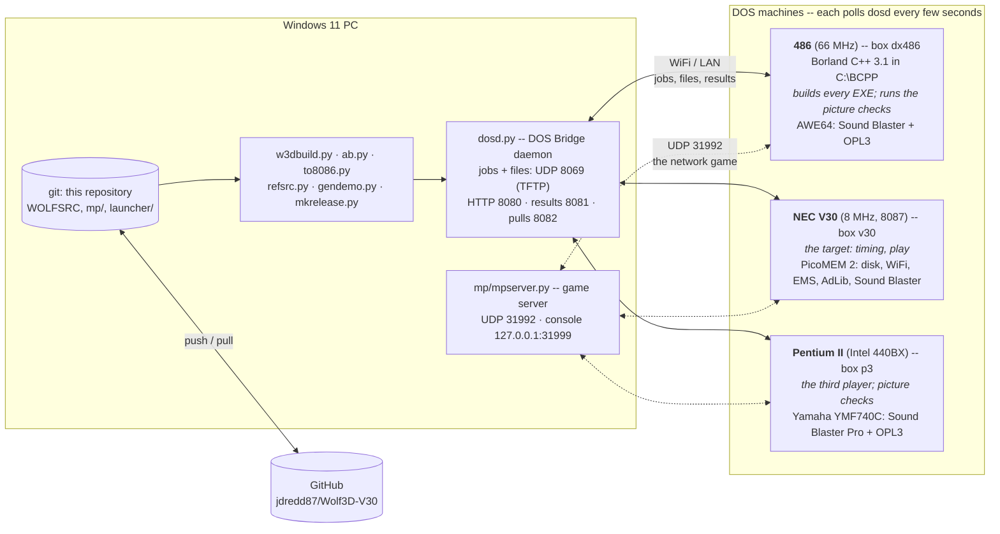
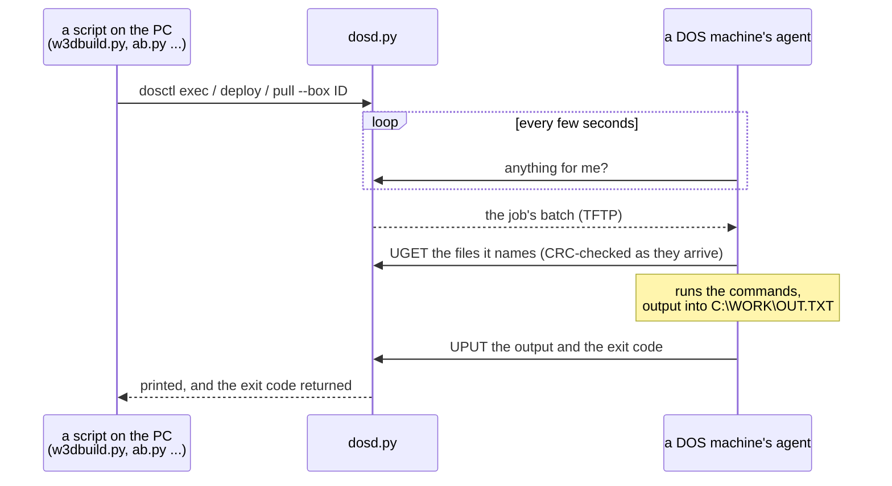
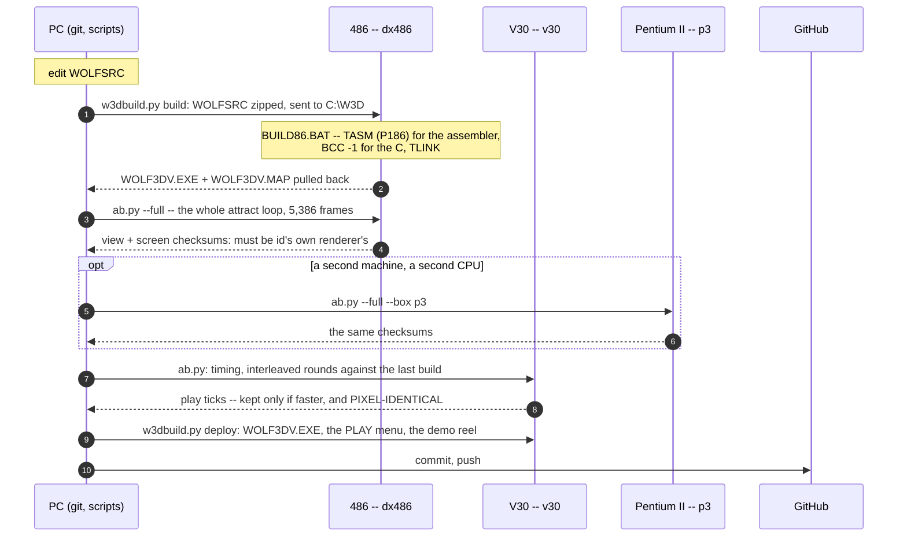
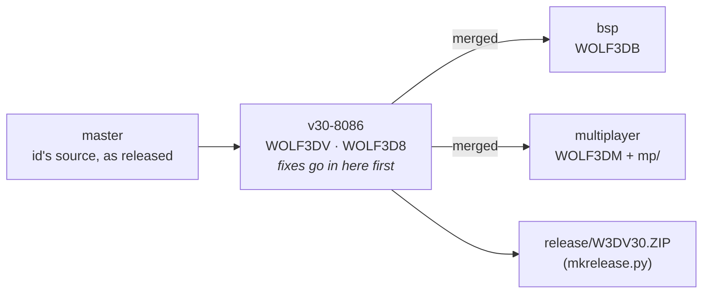
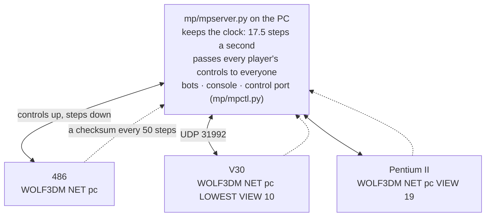

# How it is built, checked, deployed and played

Written by **StevenC** and **Claude** (Anthropic), 2026-10-15.

Nothing in this repository is compiled on the PC it is edited on. 64-bit
Windows cannot run DOS programs, and id's game is built the way id built
it -- Borland C++ 3.1 and TASM -- on a real DOS machine. Every DOS machine
here is reached over the network through
[DOS Bridge](https://github.com/jdredd87/DOSBridge), which treats a DOS PC
as a test runner: a command goes in, it runs there, its output and exit
code come back.

## The machines

Each DOS machine boots into DOS Bridge's agent (`C:\AI\AI.BAT`), which asks
`dosd` for a job every few seconds. A job is a batch file: fetch any files
it needs, run the commands, send the output back.

## Building, checking, deploying

The same 486 builds three more trees, each in a folder of its own so none
of them disturbs another:

| tree | made by | built in | gives |
|---|---|---|---|
| `WOLFSRC` (branch `v30-8086`) | -- | `C:\W3D` | `WOLF3DV.EXE`, the V20/V30/186 game |
| a copy with every 186 instruction spelled the 8086 way | `to8086.py` | `C:\W3D8` | `WOLF3D8.EXE`, for a plain 8086/8088 (`w3dbuild.py build8086`) |
| this tree with id's own renderer put back | `refsrc.py` | `C:\W3R` | `WOLF3DO.EXE`, the yardstick the checksums come from |
| branch `bsp` | -- | `C:\W3D` | `WOLF3DB.EXE` |
| branch `multiplayer` | -- | `C:\W3D` | `WOLF3DM.EXE` (and `mp/huntbot.py`'s test build `WOLF3DT.EXE`) |

## The branches

Fixes flow from `v30-8086` into the other two, never the other way.

## Playing over the network

Every machine plays every step of the same game from the same inputs --
the server sends no positions, only controls -- so the checksums every 50
steps must agree, and a machine that differs is caught at once.
[MULTIPLAYER.md](https://github.com/jdredd87/Wolf3D-V30/blob/multiplayer/MULTIPLAYER.md)
on that branch explains why that works, and how a machine joining late
catches up.

The long tests drive the same machines unattended -- every floor of every
episode, or eight hours at a stretch -- with small scripts kept out of the
repository (in the git-ignored `stage/`): they start the server, send each
machine in as a bot through `dosctl`, watch the server's log, and
power-cycle a machine that locks up (through its smart plug, which DOS
Bridge also drives) and send it back in.
